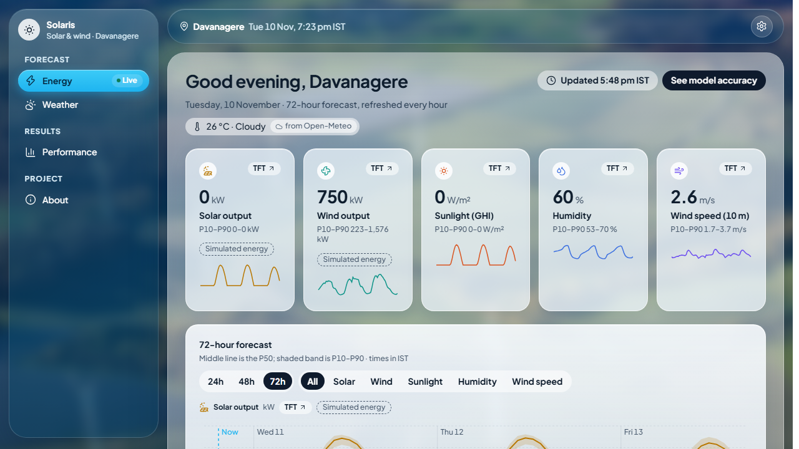
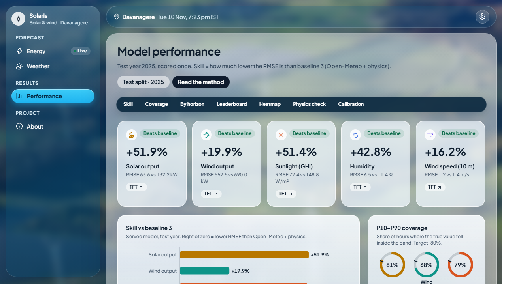
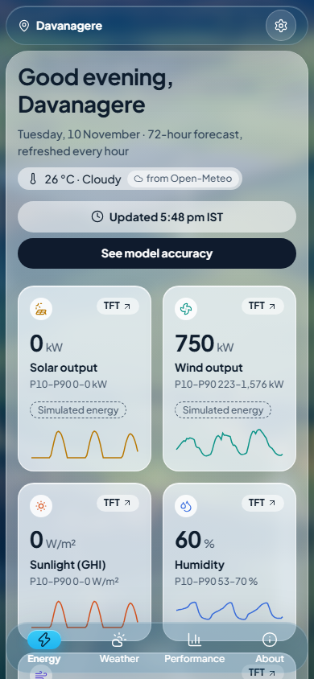

# Solar-Wind Forecast (Davanagere)

This project forecasts the next 72 hours (hour by hour) of five things for Davanagere, Karnataka, India: solar PV (photovoltaic, i.e. solar panel) power in kW, relative humidity (RH) in %, global horizontal irradiance (GHI, the sunlight reaching flat ground) in W/m², wind speed at 10 m height in m/s, and wind turbine power in kW. It runs as a website on your own laptop.

The honest question behind it: does machine learning beat the weather service's own forecast turned into power with physics? That reference is called **baseline 3** (Open-Meteo NWP, numerical weather prediction, plus physics formulas). The solar and wind power numbers are physics-simulated from weather, and the simulation was checked against real power data from Kaggle plants. Everything is scored on the test year 2025, which was evaluated once.





## Results at a glance

Test year 2025, all hours, served model TFT (Temporal Fusion Transformer, a deep-learning forecasting model) against baseline 3. RMSE (root mean square error) is the typical size of the forecast error, lower is better. Copied from `reports/evaluation/leaderboard.csv`.

| Target | Baseline 3 RMSE | TFT RMSE | TFT skill vs baseline 3 |
|---|---|---|---|
| Solar PV power (kW) | 132.2 | 63.6 | +51.9% |
| Relative humidity (%) | 11.4 | 6.5 | +42.8% |
| GHI (W/m²) | 148.8 | 72.4 | +51.4% |
| Wind speed 10 m (m/s) | 1.38 | 1.16 | +16.2% |
| Wind turbine power (kW) | 690.0 | 552.5 | +19.9% |

Skill = 1 - RMSE_model / RMSE_baseline3. Positive means better than baseline 3. Validation numbers, other models (LightGBM, LSTM (long short-term memory), GRU (gated recurrent unit)) and every figure are on the Performance page of the site and in `reports/`.

## Requirements

- Windows laptop, Python 3.12 managed by [uv](https://docs.astral.sh/uv/), Node.js 20.19+ or 22.12+.
- An NVIDIA GPU (graphics card) only for `train`. Everything else runs on the CPU.
- Internet for the first `data` run, and a Kaggle token at `~/.kaggle/kaggle.json` (Kaggle account, Settings, create token).

## Fresh-clone setup and the four commands

```
uv sync --extra train        # the ONLY sync command: bare `uv sync` uninstalls torch
uv run python -m swf check-gpu
```

If the cu134 torch index fails, change the index name/URL in `pyproject.toml` to cu132.

1. `uv run python -m swf data` downloads NASA POWER and Open-Meteo weather and the Kaggle files, then builds the clean tables, the physics simulation, the validation, the features and the baselines. Everything downloaded is cached under `data/raw/`, so a second run is quick. First run: a few minutes. If the Kaggle files are missing it stops and tells you what to do.
2. `uv run python -m swf train --accept-stale-results` retrains LightGBM, LSTM/GRU and TFT. It needs the GPU and takes hours (it re-runs the TFT timing step first). `uv run python -m swf train --lgbm-only --accept-stale-results` is the quick version (minutes). Seeds are fixed (42, in `config/lgbm.yaml` and `config/deep.yaml`), but retrains are not bit-identical because GPU maths is slightly nondeterministic. Without `--accept-stale-results` the command refuses and explains why: retraining replaces the models behind the official results, so those results would become stale. The wall-clock training deadlines `lstm.stable_by_utc` and `tft.hard_stop_utc` in `config/deep.yaml` are off (`null`) by default, so training stops only by early stopping or the epoch limit. To re-enable one, set a UTC (coordinated universal time) value there.
3. `uv run python -m swf evaluate` re-scores the baselines and every model that has saved predictions, and rewrites the tables and figures in `reports/`. It never runs the one-time test-year evaluation.
4. Build the site once, then serve it:
   ```
   npm --prefix frontend ci
   npm --prefix frontend run build
   uv run python -m swf serve
   ```
   Open http://127.0.0.1:8000 (API (application programming interface) docs at `/docs`).

Run the tests with `uv run pytest`.

## Why `evaluate` prints SKIPPED on a fresh clone

The saved model predictions are 192 MB and are not in git. On a fresh clone `evaluate` therefore re-scores the baselines, keeps the committed rows of the machine-learning models, and prints a SKIPPED list naming the models it could not re-score. That is expected, not an error. The test year was scored once by `evaluate --final` on 2026-11-09 and is never repeated, so the committed files in `reports/` are the official results. If a baseline no longer reproduces, `evaluate` prints MISMATCH and exits with code 2.

## Running the site day to day

`serve` shows the cached forecast at once and refreshes from Open-Meteo on start-up and every hour. The cache is the SQLite database `data/app.db`, created on the first `serve` (needs internet once). If Open-Meteo cannot be reached the page keeps the cached forecast and shows a stale banner. Times are UTC inside the code and shown in IST (Indian Standard Time) only in the browser.

## Folder map

- `config/` site, plant and model settings (YAML files; no coordinates are hard-coded elsewhere)
- `src/swf/` the code: `fetch`, `align`, `physics`, `validate`, `features`, `models`, `evaluate`, `predict`, `api`, `core`, `coverage`
- `models/` trained model files and `models/deployed/registry.json` (the served model)
- `reports/` the official evaluation tables and figures
- `frontend/` the React website
- `docs/` `PRD.md` (the specification), `data_notes.md`, `viva.md` (viva notes), screenshots
- `tests/` automated tests
- `data/` downloaded and built data (not in git)

## Data sources and licences

- Weather data by Open-Meteo.com (CC BY 4.0, a licence that requires giving credit).
- NASA POWER data courtesy of NASA Langley Research Center.
- Kaggle: "Solar Power Generation Data" (`anikannal/solar-power-generation-data`) and "Wind Turbine SCADA Dataset" (`berkerisen/wind-turbine-scada-dataset`), used to check the physics simulation.

The code is under the MIT licence, see [LICENSE](LICENSE). Viva notes: [docs/viva.md](docs/viva.md). Full specification: [docs/PRD.md](docs/PRD.md).
